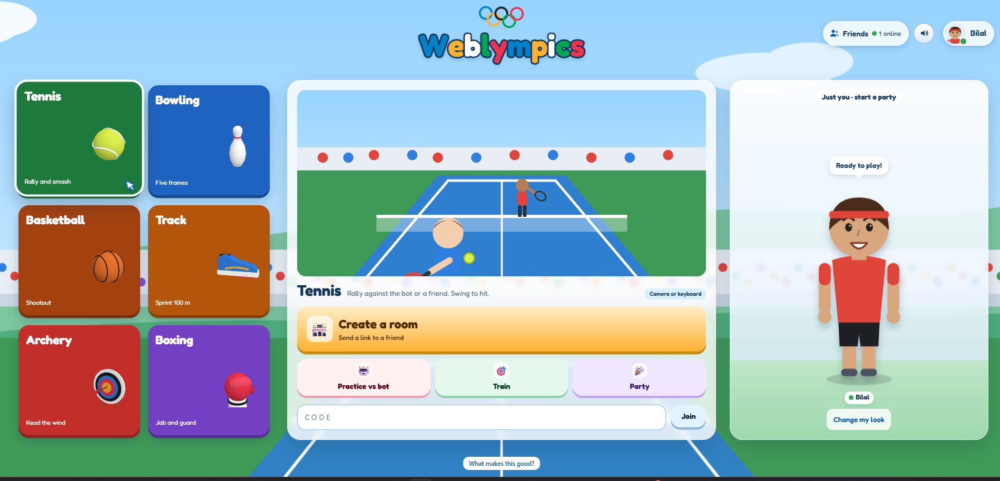
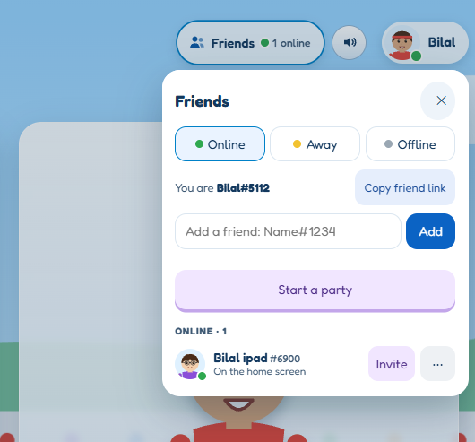
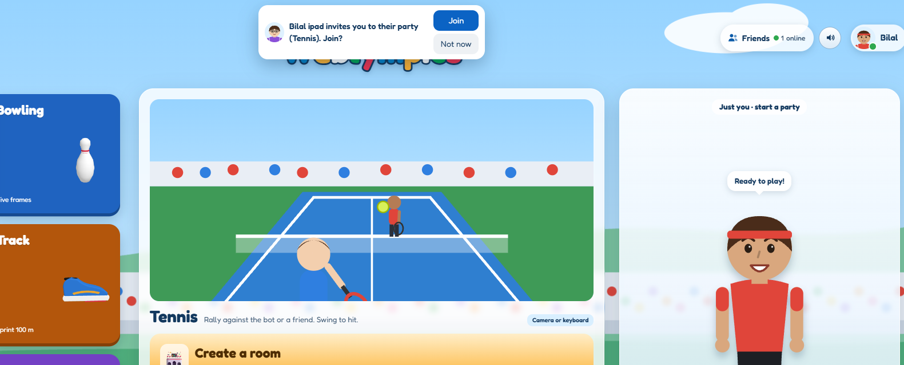
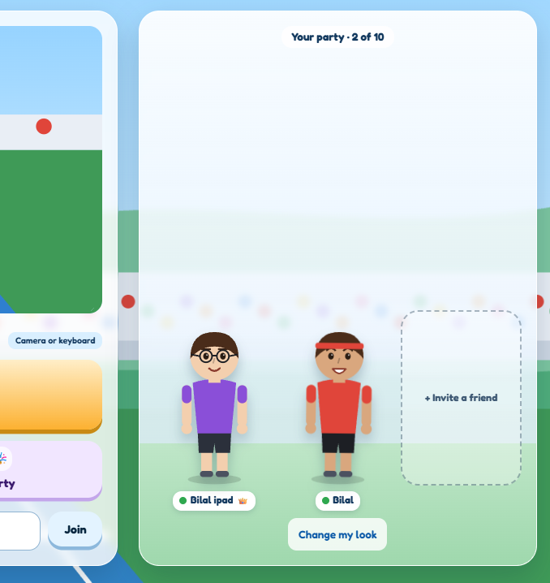
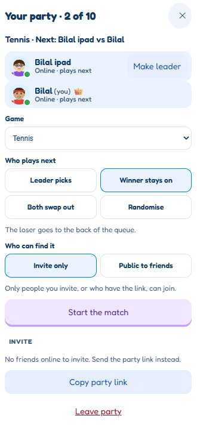

# Weblympics

An immersive webcam-controlled sports game, played against a bot or a friend over the web. Six events: tennis, bowling, archery, a track sprint, boxing and a basketball shootout.



## Inspiration

Weblympics is a homage to the Wii and Kinect sports games I grew up on in the 2010s. Those games needed extra hardware. Weblympics brings the same immersive play to a browser tab, on a device you already own with a camera. The sports and mechanics come from playing those games and watching others play them, adapted to a webcam.

## What "good" means here

What made the Wii and Kinect games fun was that they were casual and easy enough for any age, with little skill gap because the mechanics were simple, and nothing rewarded being a "pro". Weblympics follows that and works in tight spaces. Good here means a stranger can load the page and be playing with a friend within a minute, with no tutorial or account.

- **One simple move per sport.** The move is the real one: swing, throw, run on the spot, jab, push. Never a combination or a button chart.
- **Easy to play, hard to dominate.** Webcam tracking is noisy and lag is real, so I cut precise controls and kept forgiving ones. Games are also more enjoyable when both players feel on par, for example in longer tennis rallies.
- **Features with a purpose.** Each exists to get friends playing together: invites, parties, spectating and easy rotation of players.
- **Optional depth.** Training and practice modes are for anyone who wants to improve. Nobody has to use them.

### What I left out, on purpose

- **Ratings and a leaderboard.** They go against the casual play the game is made for. Your profile shows only a count of matches played.
- **Precise racket control.** A racket that copies your arm was unplayable with webcam noise and lag, so tennis has a plain forehand or backhand.
- **Chat.** Others do it better. Friends can call each other on something established, and this site is where they play.

## Run it yourself

This copy lives on [bilalm-19/weblympics](https://github.com/bilalm-19/weblympics) and runs on Windows or macOS with Node 24 and pnpm. There is no public site for it right now: you run it on your own computer.

| Mode | Command | Who can play | Needs wifi | Needs internet | Browser warning |
|---|---|---|---|---|---|
| **Offline** | `pnpm local` | you, on this computer | no | only to set up | none |
| **Wifi multiplayer** (opt-in) | `pnpm lan` | devices on your wifi | yes, always | only to set up | once per device |
| **Hosted** | deploy it yourself (e.g. Fly, Render) | whoever you give the URL | no | always | none |

**Wifi and internet are different things.** The wifi is your local network: devices on it reach each other through your router. The internet is the wider world beyond the router.

- **Offline** happens on one computer, so it needs neither once set up: the wifi can be off.
- **Wifi multiplayer** always needs the wifi, since that's how the other devices reach the host. It doesn't need the internet: a router with no internet connection works.
- **Internet is only for setup.** You download the code and its packages when you install, and the camera's pose model (about 14 MB) the first time you start. Playing never needs it: the game runs on the host computer and the camera's video is processed in each browser.
- **A hosted site** needs internet the whole time, because players reach it over the internet.

### Install (once)

You need git, Node 24 and pnpm 11. On Windows, install [Git](https://git-scm.com/downloads/win) and [Node 24](https://nodejs.org/en/download) (choose v24) with their installers. On a Mac, with Homebrew:

```bash
brew install git node@24
```

Then, in a terminal (PowerShell on Windows, Terminal on a Mac):

```bash
npm install -g pnpm@11.9.0
git clone https://github.com/bilalm-19/weblympics.git
cd weblympics
pnpm install
```

If you use [mise](https://mise.jdx.dev), `mise install` in the folder installs the pinned Node and pnpm instead.

### Set up offline play

1. In the `weblympics` folder, run:
   ```bash
   pnpm local
   ```
2. Open http://localhost:8080.
3. The first start downloads the camera's pose model (about 14 MB) into `models/`, so be online that once. After that it works with the wifi off.

Details and how it works: [playing offline](docs/local.md).

### Set up wifi multiplayer

1. On the computer that hosts, in the `weblympics` folder, run:
   ```bash
   pnpm lan
   ```
2. Allow Node through the firewall when asked: on Windows choose Private networks (and set your wifi to Private), on a Mac choose Allow.
3. Everyone else on the same wifi opens the https address it prints, and taps Advanced, then continue, past the one-time warning.
4. To keep your name, looks and friends, create an account in the profile and save its recovery code.

Keep the router on while you play; it needs no internet. Full setup for Windows and macOS, and what to check if someone can't connect: [wifi multiplayer](docs/lan.md).

### Hosting it

Deploy the `Dockerfile`'s image to a hosting service with a volume at `/data`. Nothing deploys from this repo.

## Playing with friends

Invite a friend by their short **Name#1234** tag, or share a **room code** they type in, so nobody pastes long links, and the hassle of sending party codes to friends is removed. Parties hold up to 10: the leader picks the game and who plays next, two sit and the rest watch (until their go). Friends show as online, away or offline, and you can hide.






## Controls

The webcam is the default, and "Use keyboard instead" is always available.

- **Tennis:** swing, palm out for a forehand, back of the hand for a backhand.
- **Archery:** hold an imaginary bow, pull back to draw, let go to shoot.
- **Track:** run on the spot.
- **Bowling:** choose your spot, hold and let go.
- **Boxing:** jab, guard high or low, or lean away.
- **Basketball:** push up towards the hoop.

Every rule and key is in [`docs/game-rules.md`](docs/game-rules.md).

A tennis rally and a basketball shot, played with the camera:

https://github.com/user-attachments/assets/9feb39fa-a819-45bc-ab69-50abd498c9c8

https://github.com/user-attachments/assets/62c12614-b6a5-4fbd-aae0-314ca9b8b712

## Many people, live, and still there tomorrow

- **Multi-user.** Each browser is its own person, told apart by a cookie the server sets (guest or passkey account). A room has two seats and up to 10 watchers.
- **Real-time.** Updates are pushed over a WebSocket, so a swing, a score or a friend coming online shows on every screen live, with no reload.
- **Persistent.** Accounts, friends, settings and finished matches are in SQLite on the server's disk (a hosting volume, or `data/` on your computer when you run it yourself), so they survive a restart or redeploy. Live rooms and parties are in memory, so a restart ends a match in progress.

## What is enforced, and what is judged

**Enforced in `spec/`:** server-owned hits, the lag numbers ([ADR 001](docs/adr/001-who-wins-under-lag.md)), no video leaving the browser (the page's Content Security Policy allows only this server and the pose model's hosts), logs without names, and room and friend rules. **Judged by people:** whether a move feels natural, which I playtested with peers. How I judged it is in [`PROCESS.md`](PROCESS.md).
